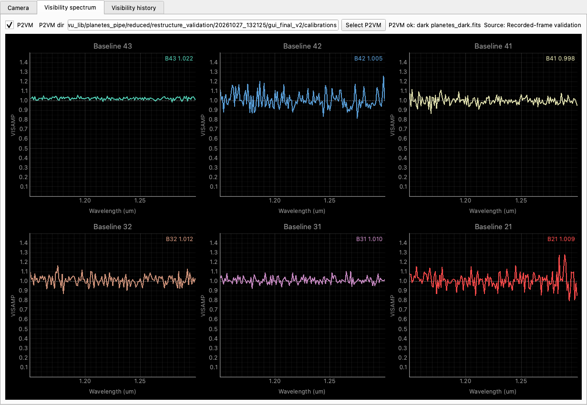

# PLANETES 0.3 修改汇报

2026-10-27。新版按科学任务整理了整个 package，Python、PyEsoRex 和实际
Qt6 GUI 共用计算。完整真实数据回归中，在相同数值环境和对应的 Numba
缓存状态下，旧版的 27 个科学字段全部逐位保持；Python 与 ESO 的 7 个产品、
科学参数和父标定指纹也一致。

这次完成的是科学代码、数据契约和执行接口的整理。结果仍是仪器级观测量，
不等于已经满足全部 ESO 最终交付或 Phase 3 要求。

## 修改位置和目的

| 原来的组织 | 当前组织 | 实际作用 |
| --- | --- | --- |
| processing.py 与 algorithms/ 同时组织任务 | dark / flat / wavelength / p2vm / reduction.py | 一项科学任务放在一个模块；文件入口与数组函数名称明确 |
| product.py 与 io/products.py 容易混淆 | models.py 与 fits.py | 前者定义科学对象、单位、轴和关系；后者负责读取和编码 |
| 暗场附着在 flat，暗场选择由各入口处理 | 独立 dark 任务、DarkCalibration 和 DarkImage | 完整统计与仅用于相减的图像有不同类型；flat 必须用完整统计 |
| 实时独立实现及自身网格 | FrameReducer + 共享 extraction / normalization | 使用 P2VM 保存的网格、相同扣暗规则和 flags |
| 对形状相同的标定缺少关联约束 | 科学指纹和父标定关系 | 拒绝不同 flat/wave/P2VM 混用；预备状态保存只读数组快照 |
| 部分参数隐藏在计算/框架层 | 普通科学函数默认值，PyCPL 映射 | 宽度、阈值、网格、相位开关和 GD 范围含义一致 |
| DFS 头与产品填充可能分步失败 | 临时目录中完成、签名、读回后原子发布 | 失败不留下最终名半成品；文件及符号链接均不覆盖 |
| bench 中另有科学算法 | 仅保留公共核心的计时示例 | 实时示例不再维护第二份算法 |
| import 时设置日志/绘图样式 | 显式 configure_logging / 绘图调用 | 导入数值库不改变应用的日志和绘图全局设置 |

旧 Python API 和 schema-1 FITS 不做兼容包装。新增 schema 2 的 7 个产品类别，
科学数组有明确单位/轴；基线映射有零基索引表，暗场记录真实帧数，复数与布尔
flags 无损保存，全部 HDU 有校验和。30 条静态谱线的值和 origin 标签保留。
详见 [产品与参数契约](PRODUCT_CONTRACT.md)。

## 模块和数据流程

普通 Python 文件任务返回内存对象。ESO 层只映射角色/参数、调用这些任务，
再登记 DFS 产品。GUI 调用 FrameReducer；文件与单帧处理共享数值内核。
无需重新引入全局 YAML 或另一套流程调度层。

main、lamp 和 science dark 按实际用途独立选择。flat 的 BPM 由建立它的完整
暗场确定；science dark 的变化不重新定义这个 mask。相位参考可以使用独立
暗场，未提供时记录主暗场复用。science/实时采用 P2VM 的目标波长坐标，
任何输出覆盖不足均明确失败。

PNG 可用于汇报，SVG 可缩放，DOT 为可编辑源文件。

## 保留的科学定义与明确修复

保留 4T、6B、24 输出、A,C,B,D 次序、全部物理交叉项、原有默认坏像素判据、
提取选点和累加顺序、拟合和剔除规则、相位符号、归一化、16 帧分块、GD
粗网格步长和 Newton 更新、Numba cache/fastmath。开放参数不代表改变默认算法。

针对不合法或不一致的输入，新行为包括：拒绝错配的父标定、拒绝覆盖不足、
不从二维 dark 编造 RMS/BPM、ragged 提取几何用成对哨兵补齐、GUI 对无效波段
显示间隙并排除均值、GUI 暗场关闭/错误时暂停并清除当前结果。GD 上下限
约束粗搜索初始化，Newton 仍可越界；没有新增截断规则。

## 验证证据

输入为 `2026_02_05/p2vm2` 和 `sci2` 的 15 个完整原始 FITS，
总计 10,401,966,720 字节。旧版从冻结的 38341e0 源码运行，新版执行五种
真实 PyEsoRex recipe（包括三个独立 dark 调用），另跑完整 Python 调用链。
每次写入新目录，原始数据及已有产品保留。

| 检查 | 实际结果 |
| --- | --- |
| 冷启动对应冷启动 | 27/27 个旧科学字段逐位相同，映射一致 |
| 缓存复跑对应缓存复跑 | 27/27 个旧科学字段逐位相同，映射一致 |
| Python 对应 ESO | 7 个产品、44 个字段/科学指纹比较全部一致 |
| 主科学/ESO 环境测试 | 48 项全部通过，含真实 PyCPL/PyEsoRex |
| 实际 GUI 环境测试 | 48 项中 41 项通过，7 项因该环境未装 CPL/执行器而跳过 |
| FITS 完整性 | 7 个最终产品全部 HDU checksum/datasum、科学指纹及读回通过 |
| 失败写出 | DFS 临时头后失败、读回失败、并发目标、符号链接等不覆盖/不残留 |
| Qt6 实际窗口 | 录制 raw 帧下单次扣暗、display binning 不变性、暗场启停、二维 dark、错类别拒绝通过 |
| 实时核心耗时 | 1024×1280 完整 raw 单帧，预热后 128 次；均值 1.104 ms，中位数 1.100 ms，P95 1.163 ms |

实时计时包含扣暗、提取、P2VM 和 flags，不包含采集/界面绘制，也未计算
GD/差分相位。GUI 默认 fake 刷新 30 ms、台架设置默认 500 ms；此处耗时只
证明核心计算在本机该工作负载下足够快，真实台架采集仍需部署验证。

逐字段证据：[冷启动](validation/comparison_schema_final_cold.json)、
[缓存复跑](validation/comparison_schema_final_warm.json)、
[Python 与 ESO](validation/comparison_python_eso.json)。
其他记录：[测试](validation/tests.log)、[GUI 环境](validation/gui_environment_tests.log)、
[GUI 验证与计时](validation/gui_results.json)、[产品完整性](validation/summary.json)、
[环境](validation/versions.json)、[执行记录](validation/recipe_execution.json)。
完整日志和产品保留在本机：
`reduced/restructure_validation/20261027_132125/schema_final_cold`、
`schema_final_warm`、`schema_python_cold`。

旧版自身的冷编译与热缓存结果存在小差异。对应状态下逐位比较通过；本次未用
容差放宽掩盖差异，也未更换算法参数。原控制实验保留在
[历史记录](history/v0.2/validation/cache_probe.json)。跨数值环境运行也不据此
宣称逐位相同。

## 备份、Git 和恢复

本轮开始前冻结 v0.2 源码和外部 GUI：
`/Users/zexwu/zexwu_lib/planetes_pipe_backups/20261027_132125_restructure/`。
包含 `source.tar`、`source/`、原 GUI 文件、冻结计划和逐文件 SHA256；
[68 个备份文件重新核验全部相符](validation/backup_verification.json)。
最初的旧版备份 `20261027_095248/` 仍保留。生成物 build/lib 和旧 recipes 缓存
移至本轮备份的 generated/，不作为第二份源码维护。

核心整理提交为 `967e324`，分支为 `codex/scientific-core-restructure`。
Qt6 viewer 所在 devel 目录未由 Git 管理，其精确补丁、原/新哈希和恢复说明
单独保存，见 [GUI 集成](GUI_INTEGRATION.md)。旧 Qt5 viewer 和采集代码保留。

## 使用与后续

[README](../README.md) 提供五个 recipe、完整 Python 链与实时调用示例；
[examples](../examples/) 提供新 SOF 模板。用 schema 2 从 raw 重新生成标定，
不要将旧文件重命名充当新产品。发布目录提供源码归档、wheel 和哈希。wheel 已在项目外安装并通过完整测试，
五个 recipe 均可发现，实际 wave 执行使用了安装包内的默认静态参考。
见 [安装测试](validation/wheel_tests.log) 和 [默认参考验证](validation/installed_reference.json)。

下一阶段应与采集端/ESO 明确 raw 观测元数据、曝光与时间单位、分类字典和
EDPS 关联规则，再分别验证误差传播、天文传递函数、闭合相位/OIFITS 和
Phase 3。本轮没有新定义这些科学量，也未连接或操作台架硬件。
