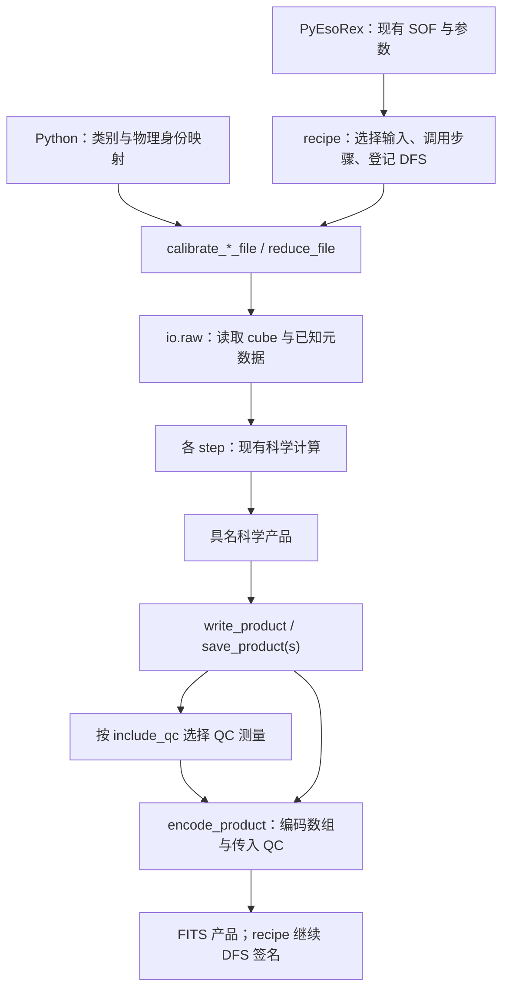

# PLANETES：台架输入和 QC 发布接口整理

后续按开发阶段需要将测试从65项精简为12项。下文65项是接口合入当时的验证记录；
当前保留核心科学计算、台架输入、FITS读写和一条PyEsoRex处理链。

本轮基于 `0e5b00d`，参考用户提供的 v0.6.0 包，吸收台架 FITS 输入和
recipe 解耦的改进。当前 P2VM 数学实现、软件版本 0.5.1、产品 format 4、
正式 raw format 3 保持一致。

## 修改内容

| 位置 | 修改及原因 |
| --- | --- |
| `io/raw.py` | 分开读取 cube 与解释已知 header；支持 primary/普通 image extension，缺失的曝光、ROI 等信息保持 None |
| `io/raw.py::identify_raw` | 支持显式 telescope/baseline → path 字典；完整快门记录仍可识别普通列表，不使用文件名或排序推断身份 |
| `flat.py`、`p2vm.py` 文件入口 | 接收上述字典；把已知类别传给 raw reader，使没有 DPR TYPE 的台架文件也能处理 |
| `dark.py::load_dark` | 多帧台架 DARK 共用 raw 元数据读取和16帧分块统计；保留单帧/二维 subtraction-only 行为 |
| `recipes/planetes_p2vm.py` | 从输入和 phase_correction 参数选择 DFS used inputs；不读取返回产品内的 phase_reference_applied 字段 |
| `io/fits.py` | encoder 只编码传入的 QC 测量；write_product 在发布入口选择是否调用 QC，默认保留原输出 |
| `recipes/dfs.py`、五个 recipe | 发布接口接收 QC 选择；所有正式 recipe 显式选择 True，保留 DFS 登记和签名 |
| `examples/reduce.py` | 用物理身份字典展示台架调用，显式选择 QC 输出 |

原始数据只读。若有 `IMAGING_DATA_SC`，按具名 detector cube 读取；否则必须只有
一个非空三维 image。多个候选时，低层 `read_raw_metadata`、`iter_raw_cube` 要求
显式 `hdu=...`。已知非 ADU 单位在读取时拒绝；缺 BUNIT 的台架文件按 ADU 约定
处理，并在 provenance 中记录 `RAW.BUNIT` 未核实。

部分已知快门也必须符合调用者给定的物理身份。已知曝光、ROI 和类别矛盾仍报错。
声明 raw format 3 的文件继续走完整元数据检查，不会降级为宽松的台架读取。
正式 SOF 标签保持原类别；缺快门的 telescope/baseline 序列使用 Python 显式字典。

## 现在的调用流程

科学标定链仍是 DARK/BAD → FLAT → WAVE → P2VM；科学处理消费自己的 DARK、
FLAT、WAVE 和 P2VM。仪器相位参照仍可单独选择 DARK，与天文传递函数标定分开。

`write_product(path, product)` 保留原 QC；`include_qc=False` 跳过 QC 计算和附加。
`qc.measure_quality(product)` 可以单独调用。`encode_product(..., quality=...)`
只编码已经算好的数值和不可用原因。QC 选择不改变科学数组或内容指纹。

## 验证结果

| 检查 | 实际结果 |
| --- | --- |
| 测试 | 65项通过，包括实际 PyCPL/PyEsoRex 集成；没有跳过项 |
| 台架输入 | primary/extension cube、17帧分块、缺失元数据、显式身份及部分快门冲突、单位错误、多cube选择、损坏正式格式拒绝 |
| 台架计算 | 相同像素制作的无完整header样例，通过Python字典生成FLAT与P2VM；数值与正式输入相同，未知信息被保留 |
| 真实数据 | 15份既有标准化raw，三份DARK、FLAT、WAVE、P2VM及science，新旧各跑冷/热两轮完整链 |
| 科学数组 | 每轮37项，共74个数组的dtype、shape和字节完全一致 |
| 产品语义及QC | 两轮共20份产品的内容指纹、实际参数、父标定和全部ESO QC值一致 |
| 相位参照分支 | 启用/禁用/缺失 × 15/17通道，非默认GD范围；66个数组及内容指纹/参数完全一致 |
| 静态检查 | Ruff、格式及diff空白检查通过 |

对照使用冻结的原版本、同一数值环境和分别匹配的冷/热缓存。
这些结果验证本轮接口调整保持已有科学结果；实际台架采集的最终关键词映射仍需
结合新采集文件确认。临时header兼容不代表ESO数据字典或最终产品已获批准。

## 范围与后续

未整包覆盖v0.6.0：保留当前已验证的P2VM辅助函数和物理命名，不新增临时SOF标签，
不引入golden NPZ。新增的必要检查留在raw/I/O边界，未扩展科学循环中的guard代码。

本轮完成raw接口、recipe输入选择与QC发布边界。现有`products.py`以及部分
`compute_*`内的provenance/父标定指纹还保留；下一轮可以按计算步骤逐个移到文件
组装边界。WAVE/REDUCE可读性整理也继续按原计划单独处理。

修改前源码及一次性回归脚本：

`/Users/zexwu/zexwu_lib/planetes_pipe_backups/20261028_171800_bench_interface/`

本轮日志、数据产品与比较结果：

`reduced/bench_interface/20261028_171800/`

---

# PLANETES：P2VM 可读性整理，第1步

本轮基于 `2cc9e95`（0.5.1），完成计划中的第1步：整理 p2vm.py 的科学流程与
局部命名。计算、参数、返回产品和 FITS format 4 保持一致。

## 从哪里读代码

`calibrate_p2vm_file()` 仍负责文件输入与标定组合；
`compute_p2vm()` 从199行缩短到125行，按实际物理操作调用同文件的 helper：

| 函数 | 科学职责 |
| --- | --- |
| fit_ellipse_linear | 对 A,C,B,D 输出拟合相位和归一化 ellipse radius |
| _estimate_scan_opd | 用中央半波段计算 OPD/GD，并去除 OPD 零点 |
| _fit_interferometric_response | 对全部24输出拟合 cos/sin/DC，保留相位、幅度、DC和拟合RMS |
| _fit_photometric_transmission | 以各望远镜光谱的frame median构造transmission，保留原初始归一化 |
| _normalize_response | 按原顺序完成A输出相位、transmission和coherence归一化 |
| build_v2pm_matrix / _invert_v2pm | 构造完整响应矩阵，并逐波长求伪逆 |
| _correct_phase_reference | 可选仪器相位参照修正；随后按同一路径重建、求逆 |

所有计算继续位于 [p2vm.py](../planetes/p2vm.py)。没有增加算法目录、中间状态类
或单独的预处理产品。求逆 helper 由相位修正前后两处共用。

## 命名和物理含义

- baseline、output、telescope_spectra、baseline_spectra、wavelength_m 和
  dc_term_adu 等局部名称直接说明实际物理量。
- 旧局部 visamp 改成 ellipse_radius。它是归一化椭圆坐标的半径，
  不直接代表最终物理 visibility amplitude。
- 相位参照修正中的旧局部 opl 改成 telescope_phase_rad：原公式给出的是
  参考波长上的相位，而非以米表示的光程。只改名称，原公式保持一致。
- phase-reference 数据反演得到的相干通量使用 reference_coherent_flux_adu，
  避免原 vis_ft 名称暗示存在另一台 FT 探测器。

原有7个函数的参数列表保持一致。持久化字段 ellipse_amplitude、OPD/GD、
完整24输出响应及所有 provenance 字段也保持原义和原值。

## 验证

| 检查 | 实际结果 |
| --- | --- |
| 改动前基线 | 冻结0.5.1源码并重新运行，55项测试通过 |
| 改动后测试 | 56项通过，包含真实PyCPL/PyEsoRex、非默认参数及现有科学检查 |
| 新增物理例子 | 无噪声A,C,B,D条纹contrast相差8倍，拟合ellipse radius均为1，并保留原相位方向；旧实现也通过此检查 |
| 真实数据 | 15份标准化raw，三份DARK、FLAT、WAVE、P2VM、science，旧/新冷/热分别完整运行 |
| 科学数组 | 每轮37项，两轮共74个数组的dtype、shape、字节完全一致 |
| 产品内容 | 两轮共20份产品的指纹、实际参数、父标定和全部ESO QC值一致 |
| 相位参照分支 | 启用、禁用、缺失 × 15/17通道，使用非默认GD范围；6个受控例子中66个P2VM数组及指纹/参数完全一致 |
| 静态检查 | Ruff、格式、语法检查通过；现有模块依赖无环 |

对照使用相同Python/NumPy/Numba环境，并分别匹配冷/热缓存状态。
数值一致性支持本轮组织改动保留已有结果；不替代独立的台架准确度实验。

## 兼容和后续

Python调用入口、软件版本0.5.1和产品format 4保持一致，已有标定可继续使用。
本轮没有改变FITS/QC/raw的接口、处理规则或科学选择。

下一步按已讨论的顺序整理WAVE/REDUCE，再独立处理产品/provenance边界、
bench raw兼容和可选QC。

修改前源码及一次性验证脚本/日志备份：

`/Users/zexwu/zexwu_lib/planetes_pipe_backups/20261028_095032_p2vm_readability/`

本轮数据产品和比较结果：

`reduced/p2vm_readability/20261028_095032/`

[上一轮接口整理报告](https://github.com/zexwu/planetes_pipe/blob/2cc9e9597b528bc09909f49a0abeeca01fc2b459/docs/CHANGE_REPORT.md)
保留0.5.1的接口、安装和GUI验证说明。
