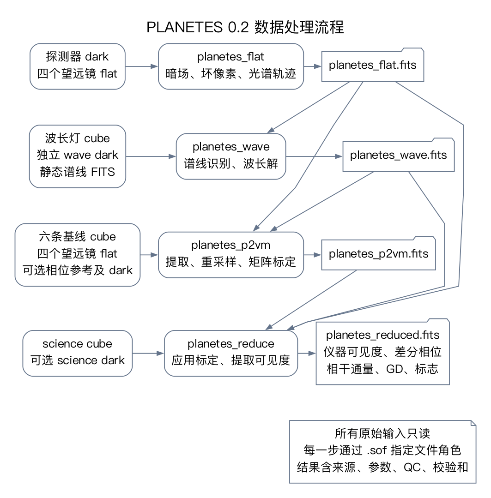
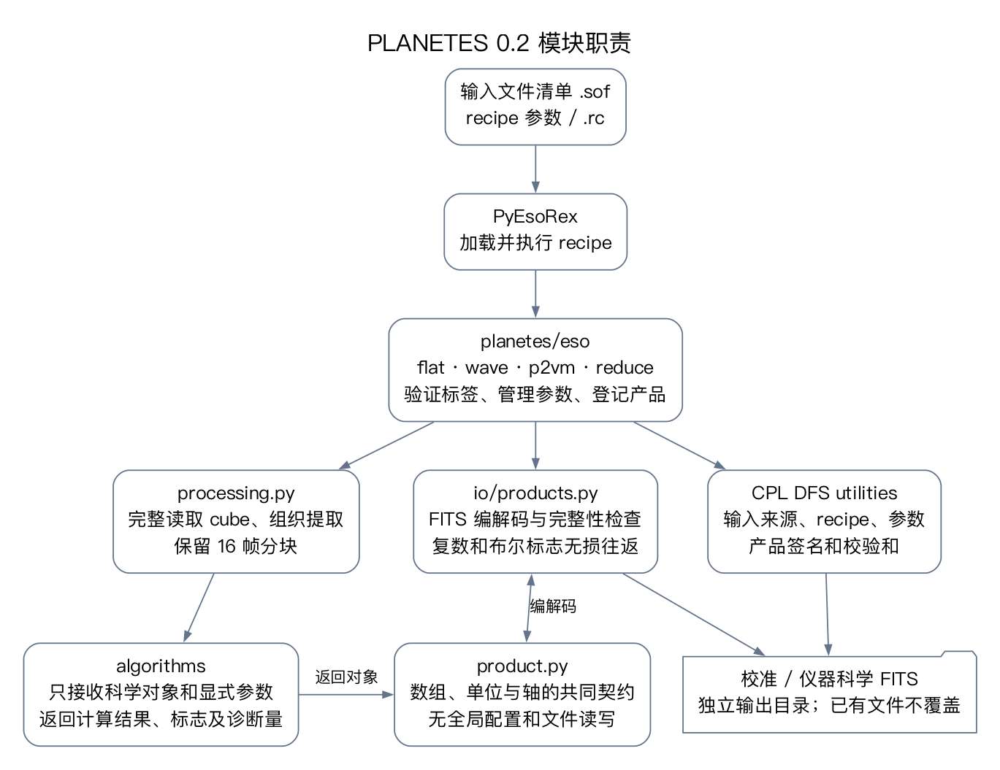

# PLANETES 0.2 修改汇报

2026 年 10 月 27 日。这个版本将 flat、wave、P2VM 和科学 reduction 统一为四个可运行的 PyCPL recipe，正式运行不再读取项目 YAML。科学计算与输入输出分离，所有阶段使用可追溯的 FITS 产品。与备份旧版处理同一组完整台架原始数据、并匹配 Numba 缓存状态时，四类产品的 27 个字段一致：数值数组逐位相同，基线映射完全相同。

## 原版本备份

备份目录是 `/Users/zexwu/zexwu_lib/planetes_pipe_backups/20261027_095248/`。

| 备份 | 内容 |
| --- | --- |
| `original_head/`、`original_head.tar.gz` | 原始提交 `dd923f62bf76c06246af4993569da0f98be7b89d` 的代码 |
| `before_update/`、`before_update.tar.gz` | 本轮修改前的工作区代码，包含上一轮 P2VM 试点及未提交文件 |
| `manifest.json` | 逐文件 SHA256 与两个归档的哈希 |
| `working_tree.patch` | 本轮修改前相对原始提交的补丁 |

工作区快照共 42 个文件，复制后逐文件核对了哈希。原始数据、已有科学产品、Python 环境和原生库没有重复打包，也没有覆盖。备份恢复说明在该目录的 `README.md` 中。

## 修改了哪些地方

| 原位置或原方式 | 新位置或新方式 | 目的和行为 |
| --- | --- | --- |
| `main.py`、`config.py`、`conf.yaml` | 从活动版本退役；运行入口为 PyEsoRex | 文件由 SOF 标签指定，参数由 recipe 声明；不同时维护第二套配置入口 |
| `recipes/flat.py` | `algorithms/flat.py` 和 `eso/flat.py` | 计算只接收暗场统计和 flat 数组；recipe 负责读取完整 cube 并登记结果 |
| `recipes/wavelength.py` | `algorithms/wavelength.py`、`io/reference.py` 和 `eso/wavelength.py` | 波长拟合与文件读取分离；静态谱线以 FITS 输入并记录来源 |
| `recipes/preproc.py` | `processing.py` 和 `algorithms/extraction.py` | 分离完整 cube 读取、暗场选择、数组提取与重采样；不传递全局配置 |
| P2VM 试点 | `algorithms/p2vm.py`、`eso/p2vm.py` 和公共 ESO 工具 | 保留相位开关、椭圆拟合、归一化和求逆；输入标签与产品登记复用公共函数 |
| `recipes/reduction.py` | `algorithms/reduction.py` 和 `eso/reduction.py` | 使用明确的光谱和标定对象计算仪器可见度、GD、差分相位及标志 |
| 产品模型与 NPZ 读写 | `product.py` 与 `io/products.py` | 模型只表达科学内容；统一 FITS 编解码、单位、轴、通道映射和完整性检查 |
| `recipes/plotting.py` | `plotting.py` 的 `plot_reduced` | 直接接收 ReducedProduct，保留诊断图计算；已有输出不覆盖 |
| `bench/` 的旧 NPZ/YAML 路径 | FITS 标定产品和脚本内显式文件路径 | 保留实时试验的计算与计时循环，不作为正式 recipe 安装 |
| 打包与测试 | 版本 0.2.0、全部新模块、静态参考 FITS 和 ESO 可选依赖 | wheel 可安装；科学模块本身可在未安装 PyCPL 时使用 |

共用的 `eso/common.py` 只处理文件标签、输出文件保护、CPL DFS 来源记录和产品登记。它不再实现另一套流程调度系统。`product.py` 中的 dataclass 是模块之间的数据契约，算法层不接收 FrameSet、输出目录或全局 PipelineConfig。

## 实际运行流程

每个 recipe 完成一项完整任务，并在独立目录写出产品。flat 产品供后续三个步骤使用，wave 产品供 P2VM 和 reduction 使用，P2VM 产品供 reduction 使用。提取后的校准光谱只在 P2VM recipe 内存中传递，没有额外的 preprocessing 缓存产品。

PNG 适合直接查看或汇报，SVG 适合缩放，旁边的 `.dot` 文件可编辑后重新生成。

## 科学定义和文件格式

本轮保留以下定义：4 个望远镜、6 条基线、24 个输出、A,C,B,D 顺序、全部交叉项、原有坏像素阈值和提取 mask、151 通道的 1.15–1.30 um 公共网格、拟合次数和截断、相位校正默认值、science/phase-reference 各自的 dark、GD 搜索范围和可见度归一化。原始 cube 仍按 16 帧分块完整读取。

谱线参考增加了 FITS 载体，30 个波长值与原 ECSV 除以 1000 后完全相同。ECSV 原文件及每条谱线的来源标签仍保留，FITS 头记录其文件名和 SHA256。

FITS 中明确保存单位、Python 数组轴、零基索引和实际望远镜顺序。复数相干通量分别保存实部与虚部，读回时逐分量赋值；科学 flags 以 0/1 字节存储并还原为布尔数组。校准和科学输出都拒绝覆盖已有文件，填充 CPL 产品前先以只读方式验证其身份。

CPL DFS 工具写入 recipe 名称、版本、实际参数、输入文件及其类别、产品签名和校验和。新增描述性 QC 量用于记录坏像素比例、波长覆盖、矩阵条件数和无效可见度比例，未添加新的样本剔除或质量阈值。定义见 [QC 参数](QC_PARAMETERS.md)。

## 验证结果

真实数据使用现有 `2026_02_05/p2vm2` 和 `2026_02_05/sci2` 下的 15 个原始 FITS 文件，总计 10,401,966,720 字节，约 10.4 GB。旧版从备份源码运行，新版由真实 PyEsoRex 顺序执行四个 recipe。两版使用同一 Python 环境和相同科学设置，分别写入新建目录。对比区分首次冷启动和缓存复跑，不混合两种状态。

| 产品 | 比较字段数 | 结果 | 新 FITS 完整性 |
| --- | ---: | --- | --- |
| flat | 6 | 全部逐位一致 | 7 个 HDU，校验和全部通过 |
| wave | 1 | 全部逐位一致 | 2 个 HDU，校验和全部通过 |
| P2VM | 11 | 全部逐位一致 | 11 个 HDU，校验和全部通过 |
| reduced | 9 | 全部逐位一致 | 10 个 HDU，校验和全部通过 |
| 合计 | 27 | 数组字节和映射均一致 | 全部通过 |

自动测试 24 项全部通过，包含真实 PyCPL/PyEsoRex 调用、文件顺序打乱、参数开关、独立 science dark、无效标志、NaN 与复数 signed zero 的 FITS 往返，以及无 YAML 的诊断绘图接口。最终 wheel 安装到项目外的临时目录后，这 24 项测试也全部通过，确认四个 recipe 和静态谱线均随安装包提供。补齐显式 setuptools 构建配置后，锁文件检查和隔离环境的安装预演通过；Ruff、差异空白检查和 wheel 打包也通过。

证据文件：[逐字段对照](validation/comparison.json)、[数据及校验和摘要](validation/summary.json)、[自动测试记录](validation/tests.log)、[安装包测试记录](validation/wheel_tests.log)、[环境版本](validation/versions.json)。这组回归在冷启动对应冷启动、缓存复跑对应缓存复跑时各比较 27 个字段，共 54 个对应比较均通过。它证明在本次数据、环境和匹配执行状态下，架构及文件格式迁移保留了既有数值结果；它没有重新测定科学误差或仪器精度。

### Numba 缓存复现条件

复跑发现，旧版自身在首次编译与缓存加载之间并非逐位相同。控制实验使用同一份原始源码、同一环境、同一组输入，并将 `NUMBA_CACHE_DIR` 指向同一个新建目录连续运行两次，复现了相同差异。flat 的其他五个数组以及提取 mask 完全相同，trace 最大变化为 `3.8544e-7` pixel；沿处理链传播后，visibility amplitude 最大变化约 `1.2854e-7`，差分相位约 `1.4255e-5` deg。

两版的冷结果对应相同、热结果也对应相同。该实验确定了缓存状态这个触发条件，没有定位到 Numba 内部具体的指令差异。本轮保留原来的 `cache=True` 和 `fastmath=True`；若需要消除这一既有的跨缓存状态差异，应作为独立数值问题验证，不能在接口迁移中直接改变它们或放宽比较阈值。完全逐位复现应固定环境并匹配缓存状态。

证据：[两种状态的 54 个比较](validation/comparison_cache_matched.json)、[旧源码冷缓存控制实验](validation/cache_probe.json)。

实际 SOF、完整日志和新旧产品保存在：

`reduced/eso_v02_validation/20261027_095248/`

## 使用和后续边界

[README](../README.md) 给出安装、四个 recipe 的输入标签、参数和绘图接口。[examples](../examples/) 提供可填写绝对路径的 SOF 模板。执行时进入新的输出目录再调用 PyEsoRex，可同时避免覆盖已有产品和 CPL 对过长日志文件名的限制。

这个版本完成了四步运行接口和 FITS 产品迁移。`planetes_reduced.fits` 仍是仪器级结果，通量单位保留 ADU，并标记 `PLTLEVEL=INSTRUMENTAL`。后续需要与仪器采集端确定 ESO 分类及观测元数据、曝光单位和逐帧时间，制定 EDPS 分类和校准关联规则，并补齐误差传播、天文传递函数标定、闭合相位/OIFITS 和 Phase 3 验收。产品类别、QC 定义、字典以及正式交付的依赖和版权声明需要 ESO 审核。

原来的旧字段 NPZ 产品保留不动。新流程从原始数据生成新 FITS，不通过猜测旧字段含义来迁移已有科学产品。代码、报告、流程图和测试记录由 Git 维护，并另行提供源代码归档和 wheel；原始数据、运行环境、科学输出及旧版备份保留在本机。
