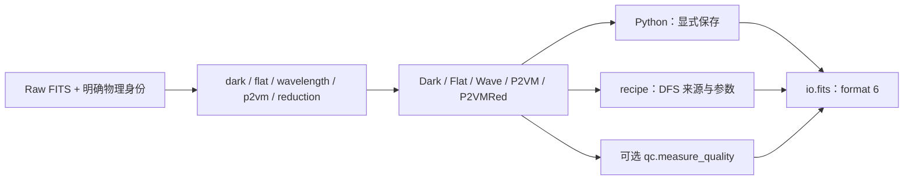

# PLANETES 0.10.0：简单科学产品与明确的步骤 API

0.7曾将`products.py`从401行缩减到119行；0.8统一步骤、字段和参数名称，
0.8.1合并Dark类型后为109行；0.9.0移除固定配对副本后为106行，继续使用普通数据类。
每个物理步骤仍在自己的文件中定义输入、参数、计算与局部 helper。

| 原名称 | 当前名称 | 内容 |
| --- | --- | --- |
| DarkCalibration / DarkImage | Dark | 必需 mean，可选 temporal RMS、frame count 和 detector setup |
| BadPixelMap | Bad | hot=1、dead=2、noisy=4 的坏像素 flags |
| FlatCalibration | Flat | detector flat、trace 和稀疏提取几何 |
| WavelengthCalibration | Wave | 逐输出波长图及可选拟合诊断 |
| P2VMCalibration | P2VM | 完整24输出响应、逆矩阵；扫描诊断可选 |
| VisibilityObservables / ReducedObservables | P2VMRed | 逐帧仪器信号；实时预览可以省略 GD/差分相位 |

旧名称直接替换，没有兼容别名。0.8.1统一使用Dark，删除DarkImage和DarkInput，
并将坏像素产品简称Bad。Dark的mean_adu必需，temporal_rms_adu和n_frames
未知时为None；单帧记录n_frames=1，RMS仍为None。减暗只用均值，BAD检测
要求RMS；完整DARK文件写出仍要求已测RMS和至少两帧。

## 删除的机制

通用 `validate()`、`validate_gd_range()`、`validate_wavelength()`、`positive()`，
产品 SHA-256 指纹、父标定依赖图、`require_parent()`、`Provenance` 以及
数值函数中的文件路径/参数来源记录全部删除。输入文件由 Python 调用者明确选择，
Python 脚本保留所用路径和参数；PyEsoRex 的输入与 recipe 参数由 CPL DFS 记录。

## 保留的必要检查

- 固定的 telescope/baseline 配对和24输出的 ABCD 映射，在实际计算和 FITS 边界检查。
- 关键输入维度在 P2VM/reduction 入口检查，防止 NumPy 广播掩盖物理轴不匹配。
- 稀疏像素范围和波长覆盖/顺序，在进入 Numba 提取与插值前检查一次。
- V2PM 必须具有16个独立数据通道，数值秩使用 NumPy 默认定义；原逐波长伪逆保留。
- 采集/文件边界保留已知曝光、ROI、单位和快门矛盾检查，以及 FITS checksum 和不覆盖写入。

这些检查直接针对所处物理步骤，没有通用的产品验证框架。

## 数据流

物理标定顺序是 DARK/BAD → FLAT → WAVE → P2VM。科学处理使用自己选择的 DARK，
以及 FLAT、WAVE 和 P2VM，返回逐帧 `P2VMRed`。平均后的 VIS/OIFITS 和天文
传递函数标定属于后续科学阶段。

## 文件与调用兼容性

新产品写 format 6，仍可读 format 4/5；旧私有 hash/provenance 被忽略。
原数组扩展、物理单位和坐标约定保持，完整 raw 仍是 format 3。
原始文件不会被读取或保存过程改写。

保留当前 main 的台架输入支持：Python 显式望远镜/基线映射、不完整 header，
非 ADU 拒绝、多 cube 歧义拒绝或显式低层 hdu 选择。SOF 类别保持不变。
Qt6采集helper使用`io.acquisition`的`CaptureMetadata`、`build_raw_header()`和`write_raw()`。GUI自己持有目录路径，不再从
FrameReducer读取目录；overlay使用`baseline_outputs`。portable patches同步更新。

QC 仍由发布入口的 `include_qc` 选择，保留当前 Python/recipe 默认 True；
传 False 可跳过测量和附加。encoder 只编码传入结果，产品数据类不管理 QC。
只保留暗场统计、BAD计数、flat flux、波长覆盖/残差和各基线coherence；
未测或非有限值省略，删除missing字典、状态映射和qc_status。

## 两个可直接阅读的层次

| Raw files → products | Arrays → scientific result |
| --- | --- |
| make_dark_products | measure_dark / detect_bad_pixels |
| make_flat | build_flat |
| make_wave | fit_wavelength_solution |
| make_p2vm | fit_p2vm |
| reduce_science | reduce_spectra |

`P2VM.matrix`保存逆矩阵，`baseline_outputs`保存输出映射；
内部光谱类叫`P2VMSpectra`。`aperture_width_pixels`表示提取全宽，
`include_phase`控制GD/差分相位。`trace_spectrum`固定返回三个数组。

删除`wavelength_grid`、`FrameReducer.calibration_dir`；`build_flat`直接接收
已减暗图像与BAD，不再依赖Dark。`_invert_v2pm`名称已经准确，继续保留。
发布函数叫`publish_outputs`，不把多文件发布描述成整体原子事务。

## 0.9.0 的两个边界

`RawMetadata`仅含category、四个可未知的shutter状态、setup；reader不再重建采集记录。
`CaptureMetadata`在`io/acquisition.py`中保存采集时间和配置来源，并由writer使用。
标定入口复用身份识别时读取的metadata，不再为同一文件重复解析。
ROI、曝光来源、detector、单位和已知shutter矛盾检查保留。

固定配对只在`instrument.BASELINE_PAIRS`定义；从三个产品类删除
`baseline_telescopes`。实际从数据推断的`baseline_outputs`仍保留。
`keep_diagnostics=False`默认不保存P2VM扫描/ellipse/DC/residual数组；设为True
可保留原来的六组诊断，计算方法不变。ESO参数对应`--keep-diagnostics=true`。

## 0.10.0 的精度边界

`io/hdu.py`集中定义浮点存盘32位、计算64位；复数对应complex64/128。
算法不声明float32/64，不做精度转换。索引和flags继续用整数/bool。
raw每16帧读入后转换一次，产品读入和GUI入口同理；写出时统一舍入。
数组级调用者在入口准备计算精度数组，不增加逐算法wrapper或dtype参数。

暗场统计合并每块的mean/M2，避免E[x²]−E[x]²。保留population RMS和原判坏规则。
按用户确认，所有浮点数组均按32位写出；波长覆盖检查仅容忍一次存盘舍入的
相对误差上界2**-24，实际越界仍拒绝。

## 验证

保留12项开发测试；测试检查存盘舍入后的数值、读入64位、复数signed zero/NaN、
稳定方差和真实波长越界拒绝。15份真实raw的完整recipe链通过，BAD、提取索引、
science flags和物理映射不变。新的科学结果包含精度策略引起的数值差异；
受控全64位内存链把计算变化与标定存盘舍入分开，数值见修改报告。
GUI窗口、模拟采集和四份迁移补丁也已核对。

SOF身份标签、file-level workflow集中、端到端分块reduction属于下一步，
本轮保持现有接口和处理方式。

[当前修改报告](CHANGE_REPORT.md)记录证据位置；
[产品接口](PRODUCT_CONTRACT.md)列出字段、文件布局和参数。
